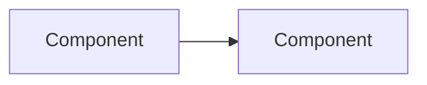

<!--
  README standard, tier 1 (showcase). Delete these comments as each section is filled in.
  Voice: technical and professional, third person or imperative. At most one origin sentence in the intro.
  No bold-lead bullets, no marketing words, every claim checked against the code.
  Never: server paths, tailnet names, LAN IPs, real money or names, tokens.
  Screenshots come from fake data only. Full standard: ~/notes/readme-standard.md on the server.
-->

<p align="center">
  
</p>

<h1 align="center">NAME</h1>

<p align="center">One-line tagline, the same text as the repo description.</p>

<p align="center">
  <!-- 1–3 badges: platform, language or stack, latest release once releases exist -->
  
</p>

NAME is WHAT IT IS. WHAT IT REPLACES OR SOLVES, SPECIFICALLY. OPTIONAL ORIGIN SENTENCE.

<!-- A visual in the first screen: screenshot, GIF, or a Mermaid diagram / terminal output for tools without a UI. -->
<p align="center">
  
</p>

## Features

- 

## Requirements

- 

## Install

<!-- If no release is published, say so and point at "Build from source". Never link an empty Releases page. -->

## How it works



| Module | Role |
|---|---|
| `src/...` |  |

## Build from source

```sh
# build
# test
```

## Layout

| Path | Contents |
|---|---|
|  |  |

## Known limitations

- 

## License

MIT. See [LICENSE](LICENSE).
