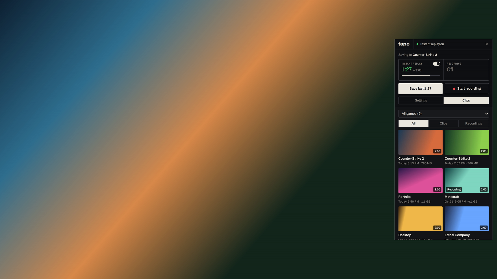
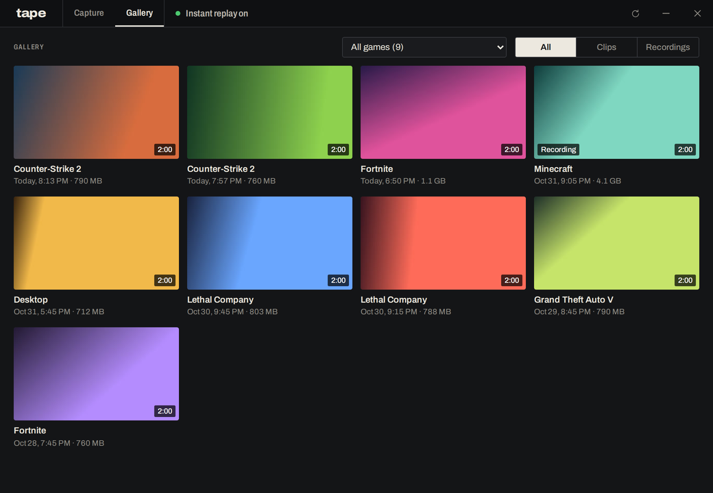
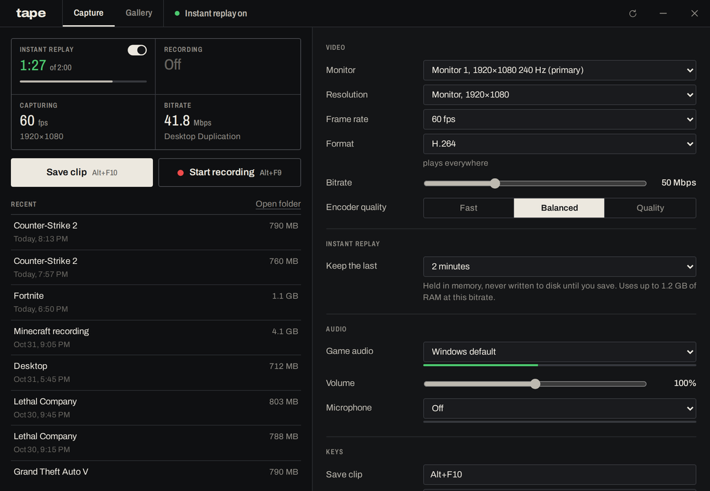
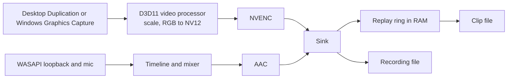

<p align="center">
  
</p>

<h1 align="center">tape</h1>

<p align="center">Instant replay and screen recording for NVIDIA GPUs on Windows.</p>

<p align="center">
  
  
  
</p>

tape replaces the capture features of the NVIDIA app with one small program. It keeps the last few minutes of the
screen and audio in memory, saves them as a clip on a hotkey, and records on demand, using NVENC directly with no
OBS or ffmpeg underneath. It was written after the NVIDIA app's instant replay kept switching itself off.

<p align="center">
  
</p>

## Features

- Instant replay held in RAM, from 30 seconds to 20 minutes. Nothing touches the disk until a clip is saved.
- Recording alongside replay, from one encoder session.
- H.264, HEVC or AV1, chosen from what the GPU reports, with bitrate, frame rate and quality settings that apply as
  soon as they change.
- Output at the monitor's resolution, scaled down, or upscaled to 1440p or 4K on a smaller monitor.
- Game audio from any output device and a microphone from any input device, mixed or on separate tracks.
- A side panel over the game on Alt+Z with replay, recording, common settings and recent clips.
- A gallery with thumbnails and a built-in player, filtered by game.
- Clips sorted into a folder per game under `Videos\Tape`, using NVIDIA's file names
  (`Fortnite 2026.10.08 - 22.14.44.26.DVR.mp4`, without `.DVR` for recordings).
- Global hotkeys, defaulting to the ones ShadowPlay uses (Alt+F10, Alt+F9, Alt+Shift+F10, Alt+Z).
- Automatic recovery when capture or the encoder crashes or hangs, with a tone if replay stays down.
- Signed updates from a button in the title bar or the tray.

<p align="center">
  
  
</p>

## Requirements

- Windows 10 2004 or later.
- An NVIDIA GPU with NVENC, driver 522 or newer, with the captured monitor connected to it.
- The Microsoft Visual C++ runtime and WebView2, which most PCs already have.
- On Windows N editions, the Media Feature Pack for AAC audio.

## Install

Download `tape_x.y.z_x64-setup.exe` from the [latest release](https://github.com/anthonyradke/tape/releases/latest)
and run it. The installer isn't code-signed, so Windows SmartScreen asks first: choose More info, then Run anyway.
Updates then install from the app.

Turn off the in-game overlay in the NVIDIA app first. It holds the same hotkeys, and tape warns if it's still running.

## How it works



Frames stay on the GPU from capture to encoder, so the only copy into system memory is the finished
bitstream.

The app is two processes. The tray and window run in one, and capture and encoding in a child process
watched by the first. If the engine crashes or stops responding inside a driver call, it is replaced
within seconds and any recording resumes in a new file. A failure that lasts more than ten seconds, or
repeated crashes, plays an alert tone, so replay can't turn off unnoticed. Failures that only return an
error (capture lost to a UAC prompt, a GPU reset, an unplugged headset) are handled inside the engine
without losing the replay buffer where possible.

Recordings use a hybrid MP4 layout. The file is valid fragmented MP4 from the first seconds, so a crash
or power cut costs at most the last two seconds. Finishing appends a normal `moov` and rewrites two box
headers in place, with no copying. Clips are written with `moov` first so they start immediately when
shared.

The overlay is an ordinary always-on-top window docked to the side of the screen and excluded from
capture with `WDA_EXCLUDEFROMCAPTURE`, not a hook into the game's renderer, which is what anti-cheat
software looks for. Its webview is created on first use and released after five minutes hidden.

Game names come from Steam's manifests and from install folders of other stores, with a short table for
games those don't cover. Anything else counts as a game if it fills a monitor without a title bar, and
takes its name from the window title. Everything else goes in `Desktop`.

Updates are ordinary GitHub releases. Each holds the installer and a `latest.json`, and the app verifies the
installer's signature against a public key built into it before running it.

| Module | Role |
|---|---|
| `crates/core` | Everything platform-free: MP4 writers, replay ring, audio mixing, game detection, file names, settings |
| `crates/nvenc` | Bindings generated from the NVENC headers |
| `crates/engine` | The engine process. `win/` is the real backend, `fake.rs` a stand-in for tests |
| `app/src-tauri` | The tray app: supervisor, hotkeys, overlay window, updates |
| `app/ui` | Plain HTML, CSS and JavaScript with no build step |

## Build from source

```sh
cargo test -p tape-core -p tape-engine -p nvenc   # needs ffmpeg on PATH for the MP4 tests
scripts/ui-preview.sh                             # the UI in a normal browser, on a fake backend
scripts/build-windows.sh                          # cross-compiles the installer on Linux with cargo-xwin
scripts/gen-nvenc.sh                              # regenerates the NVENC bindings
scripts/release.sh X.Y.Z                          # tags a release from UNRELEASED.md; CI builds and publishes it
```

`build-windows.sh` signs for updates, so it needs a key in `~/.tauri`. On Windows, `cargo build --release -p tape`
builds the app without one.

| What | How it's tested |
|---|---|
| MP4 output for all three codecs, crash recovery, audio sync | `cargo test -p tape-core`, decoded by ffmpeg |
| Engine behavior: clips, recording, restarts, hangs, device loss | `cargo test -p tape-engine`, a real process on a fake backend |
| D3D11, both capture APIs, pointer shaders, AAC | `tape --self-test report.txt` on a Windows CI runner |
| Playback, seeking and thumbnails in WebView2, overlay window | The real app on the fake engine on a Windows CI runner, driven by `app/ui/uitest.js` |
| NVENC, video processor, WASAPI | The self-test on a machine with an NVIDIA GPU, from Settings > Run self-test |

`tape --self-test <file> [settings.json]` runs each stage of the pipeline and writes a plain text report, including
a check that captured frames aren't black and a 4K encode. Settings > Run self-test starts the same command in its
own process, because a process can only duplicate an output once and replay stays running during the test.

## Layout

| Path | Contents |
|---|---|
| `crates/core/src/mp4/` | Hand-written MP4: hybrid recordings and `moov`-first clips |
| `crates/core/src/game.rs` | Game detection from Steam manifests and store folders |
| `crates/engine/src/win/` | Capture, video processor, NVENC, WASAPI, AAC, self-test |
| `app/src-tauri/src/supervisor.rs` | Starts, watches and replaces the engine |
| `app/src-tauri/src/overlay.rs` | The side panel window |
| `scripts/` | Builds, releases, the UI preview, NVENC bindings, icons |

## Known limitations

- NVIDIA GPUs only. The monitor being captured has to be connected to one.
- HDR is captured as SDR.
- A game in true exclusive fullscreen drops to the desktop while the overlay is open, as with Alt+Tab. Borderless and
  Windows' default fullscreen don't.
- Upscaling adds pixels, not detail. It suits sites that keep higher resolutions at better quality.
- Sound cues play through the normal output, so they end up in clips, and so does audio from a clip played in the app.
- Games in a window outside a known store folder aren't recognized and go in `Desktop`.
- The built-in player needs Windows' codecs for HEVC and AV1. Clips that can't play there open in the default app.
- The installer isn't code-signed.

## Credits

The NVENC bindings are generated from [nv-codec-headers](https://git.videolan.org/?p=ffmpeg/nv-codec-headers.git).
The [Archivo](https://github.com/Omnibus-Type/Archivo) font is under the SIL Open Font License, included as
`app/ui/fonts/OFL.txt`.

## License

MIT. See [LICENSE](LICENSE).
