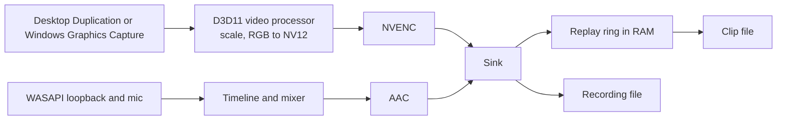

<h1 align="center">tape</h1>
<p align="center">Instant replay and screen recording for NVIDIA GPUs on Windows.</p>

tape replaces the capture features of the NVIDIA app with one small program. It keeps the last few
minutes of the screen and audio in memory, saves them as a clip on a hotkey, and records on demand.
It was written after the NVIDIA app's instant replay kept switching itself off.

Status: private, not yet run on NVIDIA hardware. See [Testing](#testing).

## Features

- Instant replay held in RAM, from 30 seconds to 20 minutes. Nothing touches the disk until a clip is saved.
- Recording alongside replay, from one encoder session.
- H.264, HEVC or AV1, chosen from what the GPU reports, at the monitor's resolution or scaled down,
  with bitrate, frame rate and quality settings that apply as soon as they change.
- Game audio from any output device and a microphone from any input device, mixed or on separate tracks.
- Global hotkeys, defaulting to the ones ShadowPlay uses (Alt+F10, Alt+F9, Alt+Shift+F10).
- Tones for a saved clip or a failure, since a fullscreen game covers everything else.

## Requirements

Windows 10 2004 or later with an NVIDIA GPU that has NVENC, driver 522 or newer, and the monitor
connected to that GPU. Windows N editions need the Media Feature Pack for AAC audio.

## How it works



Frames stay on the GPU from capture to encoder, so the only copy into system memory is the finished
bitstream.

The app is two processes. The tray and window run in one, and capture and encoding in a child process
watched by the first. If the engine crashes or stops responding inside a driver call, it is replaced
within seconds and any recording resumes in a new file. A failure that lasts more than ten seconds, or
repeated crashes, plays an alert tone, so replay can't turn off unnoticed. Failures that only return an
error (capture lost to a UAC prompt, a GPU reset, an unplugged headset) are handled inside the engine
without losing the replay buffer where possible.

Recordings use a hybrid MP4 layout. The file is valid fragmented MP4 from the first seconds, so a crash
or power cut costs at most the last two seconds. Finishing appends a normal `moov` and rewrites two box
headers in place, with no copying. Clips are written with `moov` first so they start immediately when
shared.

## Testing

| What | How |
|---|---|
| MP4 output for all three codecs, crash recovery, audio sync | `cargo test -p tape-core`, decoded by ffmpeg |
| Engine behavior: clips, recording, restarts, hangs, device loss | `cargo test -p tape-engine`, real process on a fake backend |
| D3D11, both capture APIs, pointer shaders, AAC (output decoded by ffmpeg) | `tape --self-test report.txt` on a Windows CI runner |
| NVENC, video processor, WASAPI | The same self-test on a machine with an NVIDIA GPU and sound hardware, from Settings > Run self-test |

`tape --self-test <file> [settings.json]` runs each stage of the pipeline and writes a plain text report,
including a check that captured frames aren't black. Settings > Run self-test starts the same command in its own
process, because a process can only duplicate an output once and replay stays running during the test.

## Build

```sh
cargo test -p tape-core -p tape-engine -p nvenc   # needs ffmpeg on PATH for the MP4 tests
scripts/build-windows.sh                          # cross-compiles the installer to dist/
scripts/ui-preview.sh                             # the UI in a browser with a fake backend
scripts/gen-nvenc.sh                              # regenerates the NVENC bindings
```

## Layout

| Path | What |
|---|---|
| `crates/core` | Platform-free: MP4 muxer, codec parsing, replay ring, audio timeline, settings, protocol |
| `crates/nvenc` | Bindings generated from NVIDIA's `nvEncodeAPI.h` (SDK 12.0) |
| `crates/engine` | Engine process: restart logic, mixer, `win/` hardware backend, `fake.rs` test backend |
| `app/src-tauri` | Tray, hotkeys, engine supervisor, settings file |
| `app/ui` | Plain HTML, CSS and JS |

## Known limitations

- HDR is captured as tone-mapped SDR.
- NVIDIA GPUs only, and the monitor has to be on that GPU, so most hybrid laptops won't work.
- A true exclusive-fullscreen game can appear black through Windows Graphics Capture; Desktop Duplication
  is the default for this reason.
- Replay length is limited by RAM: at 50 Mbps each minute costs up to 560 MB.
- Sound cues play through the output device, so they are recorded along with the game.

## License

MIT. See [LICENSE](LICENSE).
